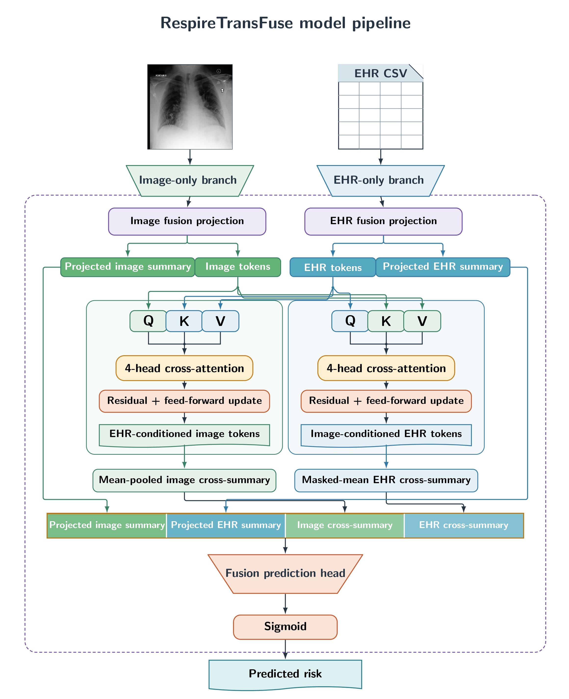
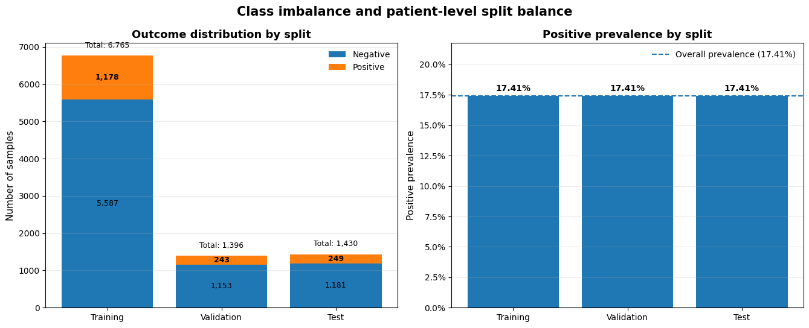
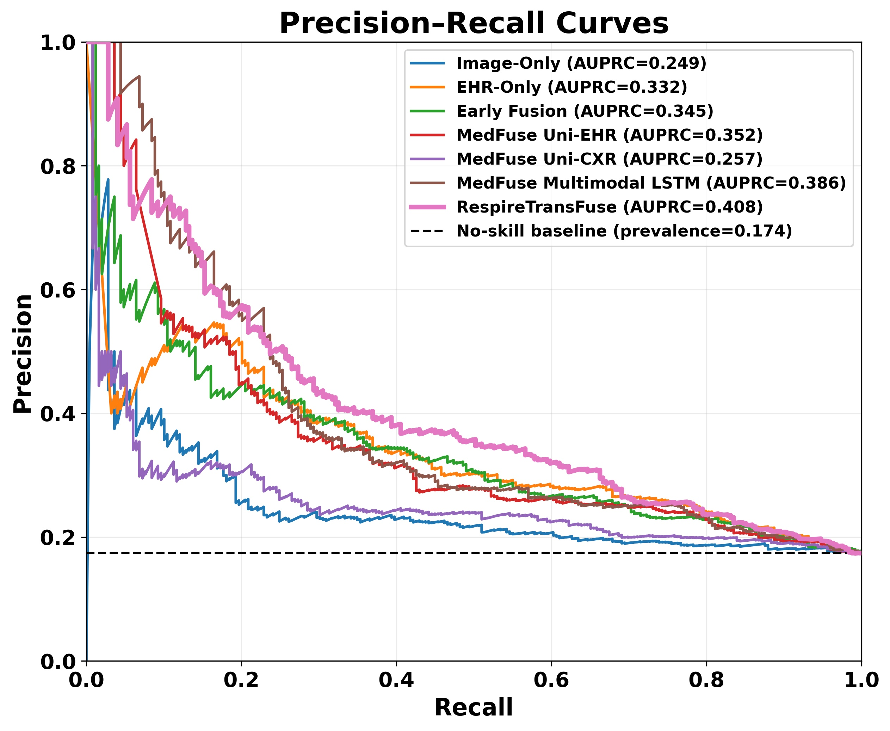
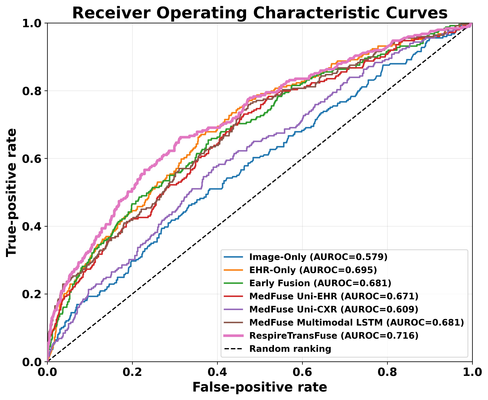
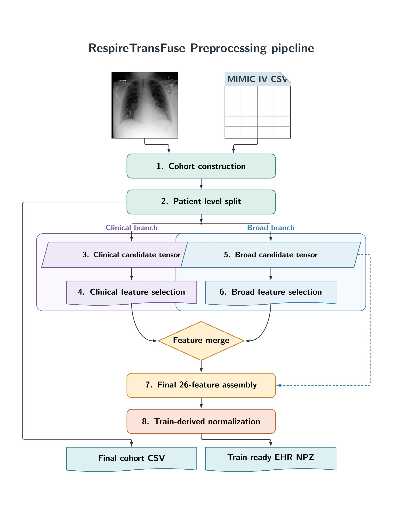

# RespireTransFuse

**Bidirectional cross-attention fusion of chest X-rays and longitudinal EHR data for respiratory deterioration prediction.**

RespireTransFuse is a multimodal model that estimates short-term respiratory deterioration risk from a chest radiograph and the preceding 24 hours of structured clinical data. A frozen EfficientNet-B0 image encoder and a mask-aware Transformer EHR encoder produce spatial and temporal tokens. Reciprocal cross-attention then lets each modality update its representation using information from the other before the final risk prediction.

<p align="center">
  
</p>

## Study task

The prediction index is an eligible frontal MIMIC-CXR radiograph linked to a MIMIC-IV ICU stay. The model uses 26 clinical variables collected during the 24 hours ending at the image time.

- **Positive:** the first qualifying respiratory-support intervention occurs within 48 hours after the image, including events recorded in a later ICU stay during the same hospitalization.
- **Negative:** no qualifying intervention occurs through 72 hours and the patient remains under hospital observation for the complete 72-hour follow-up period.
- **Excluded:** respiratory support was already present at or before the index time, the first event occurs between 48 and 72 hours, the patient dies or is discharged before 72 hours without an observed endpoint, or follow-up is uncertain.
- **Temporal safeguards:** charted values must occur no later than the index time; laboratory results must also have a store time no later than the index time.
- **Split policy:** all samples from one patient remain in a single partition.

The final cohort contains **9,591 paired samples** from **4,687 patients**, including **1,670 positive cases (17.41%)**. Patient-exclusive splits contain 6,765 training samples, 1,396 validation samples, and 1,430 held-out test samples.

<p align="center">
  
</p>

## Held-out results

All models were evaluated on the same held-out test set of 1,430 samples, including 249 positive cases. The no-skill AUPRC is the test prevalence, approximately 0.174.

| Model | Modality | Test AUROC | Test AUPRC |
| --- | --- | ---: | ---: |
| Image-Only CNN | CXR | 0.5794 | 0.2487 |
| MedFuse Uni-CXR | CXR | 0.6089 | 0.2574 |
| MedFuse Uni-EHR | EHR | 0.6714 | 0.3520 |
| Early Fusion | CXR + EHR | 0.6814 | 0.3453 |
| EHR-Only Transformer | EHR | 0.6949 | 0.3324 |
| MedFuse Multimodal LSTM | CXR + EHR | 0.6814 | 0.3862 |
| **RespireTransFuse** | **CXR + EHR** | **0.7158** | **0.4083** |

<p align="center">
  
</p>

<p align="center">
  
</p>

RespireTransFuse achieved the highest observed AUROC and AUPRC in this internal comparison. Validation-fitted logistic calibration changed its mean predicted risk from 0.1316 to 0.1776, close to the 0.1741 test prevalence, while reducing the Brier score from 0.1338 to 0.1276 and expected calibration error from 0.0716 to 0.0219. Rank-based discrimination metrics are unchanged by this monotonic calibration step.

## Model design

The repository contains four project models and three adapted MedFuse baselines:

1. **Image-Only CNN:** frozen pretrained EfficientNet-B0 with global and focused spatial pooling.
2. **EHR-Only Transformer:** 26 values plus 26 observation-mask channels, projected to width 128 and processed by local temporal convolutions and two four-head Transformer layers.
3. **Early Fusion:** normalized concatenation of the image and EHR summary representations.
4. **RespireTransFuse:** four image tokens and 24 EHR tokens projected to width 48, followed by four-head cross-attention in both directions.
5. **MedFuse Uni-CXR:** adapted ResNet-34 image baseline.
6. **MedFuse Uni-EHR:** adapted recurrent EHR baseline.
7. **MedFuse Multimodal LSTM:** adapted recurrent CXR-EHR fusion baseline.

RespireTransFuse concatenates the projected image summary, projected EHR summary, EHR-conditioned image summary, and image-conditioned EHR summary. The resulting 192-dimensional vector is classified by a 192-to-48-to-24-to-1 prediction head. See [`docs/models.md`](docs/models.md) and [`docs/experiments.md`](docs/experiments.md) for architecture and run settings.

## External resources

Large data and image-model assets are stored outside the repository:

- [Required MIMIC-IV and MIMIC-CXR project data](https://drive.google.com/drive/folders/1l-LYWFxiVTThrFozhGGk8xNpNA8jbJlt?usp=sharing)
- [CXR image-model resources](https://drive.google.com/drive/folders/1PeLDVnkaq7b-tPSXCB-zGD6pHQpzsqEv?usp=sharing)

Place or mount the downloaded data so the repository has this layout:

```text
data/raw/
|-- mimic_cxr/
|   |-- metadata/
|   `-- images/
`-- mimiciv/
    |-- hosp/
    `-- icu/
```

MIMIC data use remains subject to the applicable PhysioNet credentialing and data-use requirements.

## Installation

Python 3.10 or newer is recommended. From the repository root:

```bash
python -m venv .venv
```

Activate the environment on macOS or Linux:

```bash
source .venv/bin/activate
```

Activate it on Windows PowerShell:

```powershell
.venv\Scripts\Activate.ps1
```

Install the dependencies:

```bash
python -m pip install --upgrade pip
python -m pip install -r requirements.txt
```

For GPU training, install the PyTorch build that matches the local CUDA environment.

## Quick smoke test

The committed dummy pack contains 100 paired samples, a 24 x 26 EHR tensor, and a small image set. It checks data loading, all seven model configurations, two-epoch training, checkpoint creation, and output writing without requiring Bash:

```bash
python start_dummy_test.py
```

To inspect the commands without running training:

```bash
python start_dummy_test.py --dry-run
```

Dummy outputs are written to `outputs/dummy_100/`. These short runs verify execution and are not intended for scientific interpretation.

## Preprocessing

Run the complete cross-platform workflow from the repository root:

```bash
python start_preprocessing.py
```

<p align="center">
  
</p>

The launcher checks source files and validates every stage:

1. Build the CXR-indexed cohort using hospitalization-wide future-event lookup and strict 72-hour follow-up.
2. Assign patient-exclusive training, validation, and test partitions.
3. Aggregate eligible chart and available laboratory events into 24 hourly bins.
4. Remove variables with no training-partition observations.
5. Rank clinically constrained candidates using training-only evidence.
6. Build and screen a broader candidate tensor.
7. Merge both evidence streams into the final 26-variable registry.
8. Normalize with training-only statistics and verify tensor, feature, and cohort alignment.

Generated files are written under `data/processed/`. The detailed workflow is described in [`docs/data_pipeline.md`](docs/data_pipeline.md).

## Training

Set local paths in `configs/paths.yaml`, then run all seven configured experiments:

```bash
python start_training.py
```

Run one model by name:

```bash
python start_training.py --model respire_transfuse
python start_training.py --model medfuse_uni_cxr
```

Use `python start_training.py --help` for the complete model list or `--dry-run` to inspect commands. On Unix-like systems, `bash run_all.sh` calls the same Python launcher.

## Evaluation

Post-training analysis scripts under `scripts/eval/` generate discrimination curves, bootstrap comparisons, calibration analyses, and predicted-risk summaries. The current seven-model workflow includes raw and calibrated metric comparison plus a dedicated RespireTransFuse calibration figure. Set the `BASE` path near the top of standalone figure scripts when running outside the original project environment.

## Repository structure

```text
RespireTransFuse/
|-- configs/                 Paths, preprocessing, and experiment settings
|-- data/dummy_100/          Cross-platform seven-model smoke-test pack
|-- docs/                    Model, pipeline, experiment, and figure documentation
|-- external/medfuse_original/
|                            Adapted MedFuse baseline implementation
|-- scripts/preprocess/      Cohort and EHR preparation stages
|-- scripts/train/           Individual training entry points
|-- scripts/eval/            Analysis and plotting scripts
|-- src/respire_transfuse/   Reusable datasets, models, training, and utilities
|-- start_preprocessing.py   Validated preprocessing launcher
|-- start_training.py        Cross-platform seven-model training launcher
`-- start_dummy_test.py      Validated seven-model dummy launcher
```

## Research scope

The reported results are a retrospective internal evaluation on linked MIMIC-IV and MIMIC-CXR data. External, temporal, and prospective validation would be required before clinical use.
