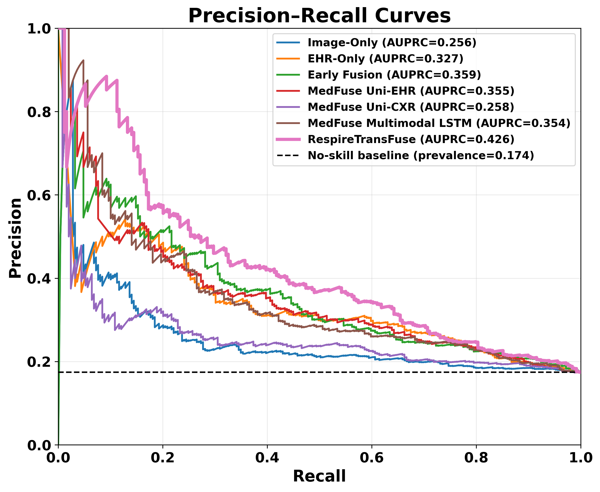
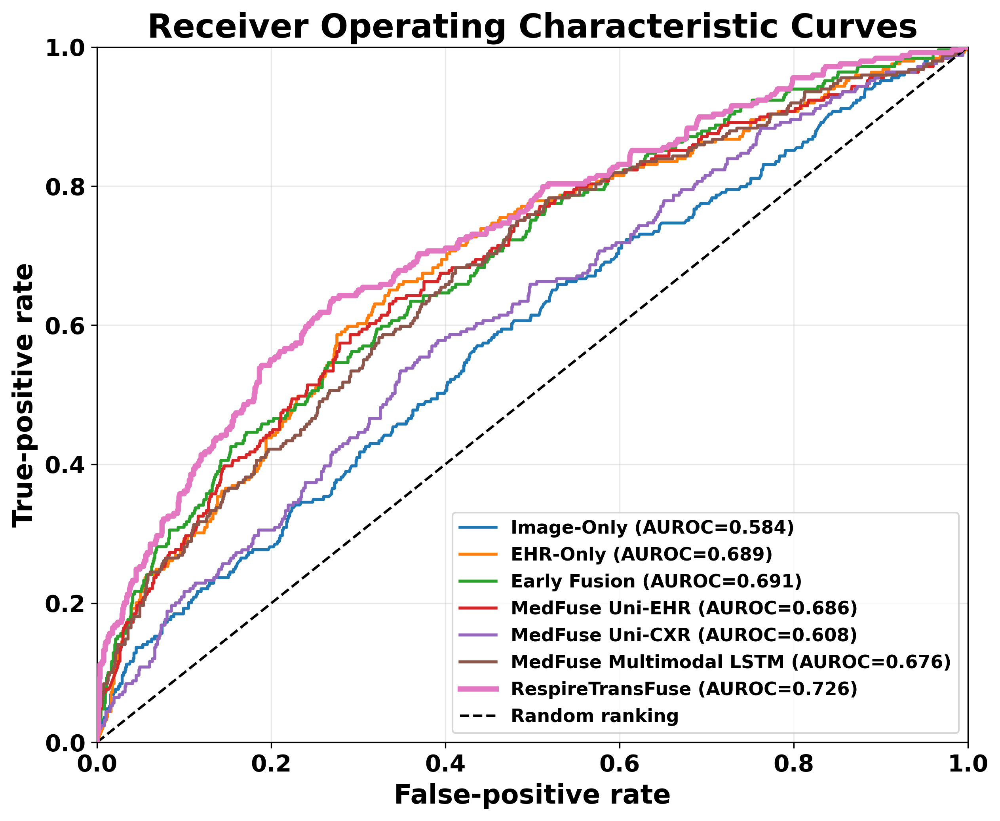

# RespireTransFuse

**Multimodal bidirectional fusion of chest X-rays and longitudinal EHR data for respiratory deterioration prediction.**

RespireTransFuse estimates short-term respiratory deterioration risk from a chest radiograph and the preceding 24 hours of structured clinical data. A frozen EfficientNet-B0 image encoder and a mask-aware Transformer EHR encoder produce spatial and temporal tokens. Reciprocal cross-attention lets each modality condition the other before the final risk prediction.

<p align="center">
  
</p>

## Study task

The prediction index is an eligible frontal MIMIC-CXR radiograph linked to a MIMIC-IV ICU stay. Each sample combines that image with 26 clinical variables collected during the preceding 24 hours.

- **Positive:** the first qualifying respiratory-support intervention occurs within 48 hours after the image. Events may be recorded in a later ICU stay within the same hospital admission.
- **Negative:** no qualifying intervention occurs through 72 hours and hospital observation covers the complete 72-hour follow-up period.
- **Excluded:** a qualifying event occurred earlier in the index ICU stay, respiratory support was active at image time, the first future event occurs from 48 to 72 hours, the image falls outside the hospitalization, or follow-up ends before 72 hours without a positive endpoint.
- **Temporal safeguards:** chart events must occur by image time. Laboratory events must also have a store time no later than the image.
- **Split policy:** all samples from a patient remain in one partition.

The final cohort contains **9,509 paired samples** from **4,668 patients**, including **1,667 positive cases (17.53%)**. Patient-exclusive splits contain 6,691 training samples, 1,389 validation samples, and 1,429 held-out test samples.

<p align="center">
  
</p>

## Held-out results

Each model was trained with seeds 40, 41, and 42 and evaluated on the same held-out test set of 1,429 samples, including 249 positive cases. The table reports the three-seed mean, sample standard deviation, and 95% patient-cluster bootstrap confidence interval.

| Model | Modality | AUROC, mean +/- SD [95% CI] | AUPRC, mean +/- SD [95% CI] |
| --- | --- | ---: | ---: |
| Image-Only CNN | CXR | 0.5803 +/- 0.0032 [0.5366, 0.6238] | 0.2508 +/- 0.0043 [0.2044, 0.3131] |
| MedFuse Uni-CXR | CXR | 0.6085 +/- 0.0006 [0.5683, 0.6496] | 0.2592 +/- 0.0012 [0.2108, 0.3213] |
| MedFuse Multimodal LSTM | CXR + EHR | 0.6733 +/- 0.0057 [0.6253, 0.7192] | 0.3484 +/- 0.0175 [0.2915, 0.4128] |
| MedFuse Uni-EHR | EHR | 0.6820 +/- 0.0063 [0.6348, 0.7272] | 0.3557 +/- 0.0020 [0.2984, 0.4212] |
| EHR-Only Transformer | EHR | 0.6922 +/- 0.0031 [0.6420, 0.7364] | 0.3308 +/- 0.0039 [0.2751, 0.3965] |
| Early Fusion | CXR + EHR | 0.6969 +/- 0.0085 [0.6552, 0.7384] | 0.3569 +/- 0.0042 [0.2969, 0.4328] |
| **RespireTransFuse** | **CXR + EHR** | **0.7134 +/- 0.0113 [0.6715, 0.7547]** | **0.4071 +/- 0.0164 [0.3400, 0.4830]** |

The following precision-recall and ROC figures show the representative seed-40 test curves. Their legend values are seed-specific and therefore differ from the three-seed summary above.

<p align="center">
  
</p>

<p align="center">
  
</p>

RespireTransFuse achieved the highest mean AUROC and AUPRC in this internal comparison. Validation-only post-hoc logistic calibration was fitted independently for every model and seed, then applied to its held-out test predictions. For RespireTransFuse, the mean calibrated Brier score was 0.1282 +/- 0.0028 and the mean 10-bin expected calibration error was 0.0220 +/- 0.0037. Calibration and risk-tertile analyses never use test labels for fitting.

## Model design

The repository evaluates four project models and three adapted MedFuse baselines:

1. **Image-Only CNN:** frozen pretrained EfficientNet-B0 with global and focused spatial pooling.
2. **EHR-Only Transformer:** 26 values plus 26 observation-mask channels, projected to width 128 and processed by local temporal convolutions and two four-head Transformer layers.
3. **Early Fusion:** normalized concatenation of the image and EHR summary representations.
4. **RespireTransFuse:** four image tokens and 24 EHR tokens projected to width 48, followed by reciprocal four-head cross-attention.
5. **MedFuse Uni-CXR:** adapted ResNet-34 image baseline.
6. **MedFuse Uni-EHR:** adapted recurrent EHR baseline.
7. **MedFuse Multimodal LSTM:** adapted recurrent CXR-EHR fusion baseline.

RespireTransFuse concatenates the projected image summary, projected EHR summary, EHR-conditioned image summary, and image-conditioned EHR summary. The resulting 192-dimensional vector is classified by a 192-to-48-to-24-to-1 head. The training objective combines fusion BCE with EHR and image auxiliary losses weighted 0.05 and 0.02. See [`docs/models.md`](docs/models.md) and [`docs/experiments.md`](docs/experiments.md).

## External resources

Large data and image-model assets are stored outside the repository:

- [Required MIMIC-IV and MIMIC-CXR project data](https://drive.google.com/drive/folders/1l-LYWFxiVTThrFozhGGk8xNpNA8jbJlt?usp=sharing)
- [CXR image-model resources](https://drive.google.com/drive/folders/1PeLDVnkaq7b-tPSXCB-zGD6pHQpzsqEv?usp=sharing)

Place or mount the downloaded data so the repository has this layout:

```text
data/raw/
|-- mimic_cxr/
|   |-- metadata/
|   `-- images/
`-- mimiciv/
    |-- hosp/
    `-- icu/
```

MIMIC data use remains subject to the applicable PhysioNet credentialing and data-use requirements.

## Installation

Python 3.10 or newer is recommended. From the repository root:

```bash
python -m venv .venv
```

Activate the environment on macOS or Linux:

```bash
source .venv/bin/activate
```

Activate it on Windows PowerShell:

```powershell
.venv\Scripts\Activate.ps1
```

Install the dependencies:

```bash
python -m pip install --upgrade pip
python -m pip install -r requirements.txt
```

For GPU training, install the PyTorch build that matches the local CUDA environment.

## Quick smoke test

The committed dummy pack contains 100 paired samples, a 24 x 26 EHR tensor, and a small image set. It checks data loading, all seven model configurations, two-epoch training, checkpoint creation, and output writing without requiring Bash:

```bash
python start_dummy_test.py
```

Inspect the commands without training:

```bash
python start_dummy_test.py --dry-run
```

Dummy outputs are written to `outputs/dummy_100/`. These short runs verify execution and are not scientific results.

## Preprocessing

Run the cross-platform workflow from the repository root:

```bash
python start_preprocessing.py
```

<p align="center">
  
</p>

The launcher builds the cohort, assigns patient-exclusive splits, constructs clinical and broad EHR candidate tensors, performs training-only feature selection, assembles the final 26-variable registry, and applies training-derived normalization. Values are aggregated into 24 hourly bins; missing entries remain masked and become zero only after standardization. Generated files are written under `data/processed/`. See [`docs/data_pipeline.md`](docs/data_pipeline.md).

## Training

Set local paths in `configs/paths.yaml`, then run the three reported seeds for all seven models:

```bash
python start_training.py
```

Run one model or one seed:

```bash
python start_training.py --model respire_transfuse
python start_training.py --model early_fusion --seeds 40
```

Use `python start_training.py --help` for the model list or `--dry-run` to inspect commands. On Unix-like systems, `bash run_all.sh` calls the same Python launcher.

## Ablations

After the full RespireTransFuse runs are available, launch the matched A0-A3 experiments:

```bash
python scripts/train/launch_respire_ablations.py
```

The variants test concatenation without cross-attention, each one-way attention direction, and reciprocal attention without auxiliary losses. The full reciprocal model is A4.

## Evaluation

Scripts under `scripts/eval/` cover discrimination curves, 2,000-repetition patient-cluster bootstrap intervals, pairwise comparisons, validation-selected thresholds, calibration, and risk summaries. The seven `*_three_seed_calibration_ci.py` entry points apply the same validation-only calibration protocol independently to Image-Only, EHR-Only, Early Fusion, all three MedFuse baselines, and RespireTransFuse.

## Repository structure

```text
RespireTransFuse/
|-- configs/                 Paths, preprocessing, and experiment settings
|-- data/dummy_100/          Cross-platform seven-model smoke-test pack
|-- docs/                    Model, pipeline, experiment, and figure documentation
|-- external/medfuse_original/
|                            Adapted MedFuse baseline implementation
|-- scripts/preprocess/      Cohort and EHR preparation stages
|-- scripts/train/           Training and ablation entry points
|-- scripts/eval/            Analysis and plotting scripts
|-- src/respire_transfuse/   Datasets, models, training, and utilities
|-- start_preprocessing.py   Validated preprocessing launcher
|-- start_training.py        Three-seed seven-model training launcher
`-- start_dummy_test.py      Seven-model dummy launcher
```

## Research scope

The reported results are a retrospective internal evaluation on linked MIMIC-IV and MIMIC-CXR data. External, temporal, and prospective validation are required before clinical use.
